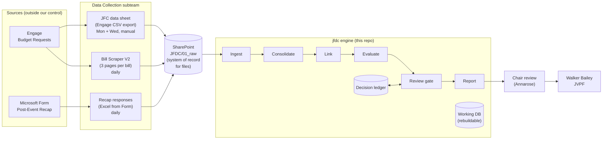
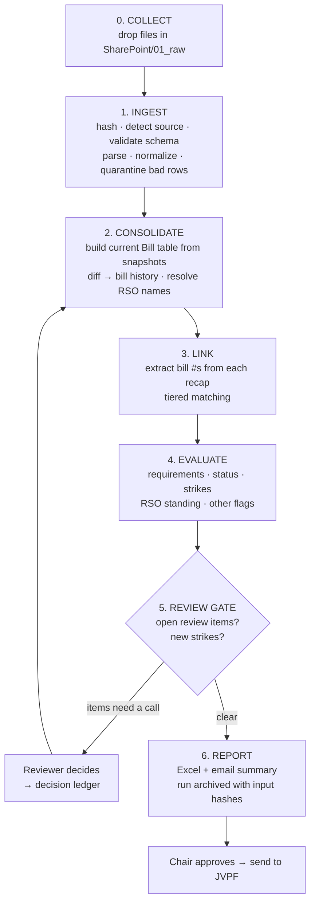
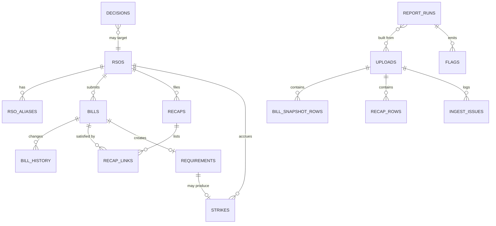

# JFDC Compliance System: Architecture & Main Workflow

**Status:** v0.3. The Phase 1 engine is implemented (`src/jfdc`, 51 tests) and has been run against real FY27 files. Decisions are in §10; pending outside changes are in `docs/PENDING_CHANGES.md`.
**Scope:** Phase 1 (daily compliance report), built so that Phase 2 (dashboard) adds a UI on top without changing the engine
**Policy basis:** Joint Policy of the SAF, rev. 9/29/2026: §9.5 (core), plus §9.1, §9.2, §9.6 and §9.8 as later flag modules

---

## 0. What the real files showed (profiled 2026-11-06)

| File | What it actually is | Grain | Notes |
|---|---|---|---|
| `Data_Repository_ScraperEngage_Data_Pasting_Site.csv` | **Engage request export, one row per line item** | 69,113 rows → 8,400 requests | **All FYs since 2020 and all funding processes** (GTSF, Parents Fund, MOVE, ANAK…), so it must be filtered by `ProcessName`. Encoded **Windows-1252, not UTF-8.** **No event date column.** |
| `JFC_Data_SheetFY27_Final_Budgets.csv` | FY27 Annual Budget totals per RSO | 134 RSOs | No budget ID and no events. Good for §9.6 cap checks only. |
| `Post_Event_Recap_Form1-153.xlsx` | Recap form responses | 153 responses (8/28 to 10/20) | The bill number, date, location and attendee fields are all **free text** |

**Join test results** (recap bill numbers against Engage `Id`):
- **Engage `Id` is the bill number** (6 digits). 148 of 149 six-digit tokens matched a request, all `Approved`: 134 FY27 Bills, 13 FY27 Budget Requests, 1 FY26 bill.
- 146 of 148 also matched the RSO exactly. Both misses were `Graduate Women in Engineering (GWiE)` vs `Graduate Women in Engineering`, which the alias table fixes.
- 47 of 150 bill fields aren't clean (`Bill # 377345`, `[Bill #26909]`, `Budget 338443 Line 17`, `N/Aa`). Extracting by pattern handles these.
- **9 recaps quote 5-digit numbers** (`27665`, `27121,27400,27452`, `26909`…) that don't exist in the export. Open blocker **B2**.
- 4 recaps have no usable number at all, which leaves them for the org + date fallback.
- 132 of the 857 approved FY27 bills have a matching recap.

**Fields the policy needs that the form doesn't have:**
- No "Did you track attendance?" question, needed for §9.5.2 and decision C2
- No "Did you use the funds?" question, needed for C2

**Recommended form change:** add both as Yes/No questions (see §3, Stage 4a).

### Event dates: the bill page (resolves B1)

The Engage bill page (and its **PDF export**) has an *Additional Information* section with these answers:
- **"Is this request intended to be used with an event (Section A)?"** Non-event bills (storage,
  equipment, travel) have **no recap requirement**. When this answer isn't available, the engine falls
  back to "has a Section A line item" from the export.
- **"Please state when your event is"**: free text such as `06/26/26` or `10/16-10/18/26`. The last date is used (C3).
- **"Have you submitted Post-Event Recap Forms for ALL events…?"**: the RSO's attestation, cross-checked
  against reality (`R-9.5-ATTESTATION`).
- Expected attendance (`100 GT, 5 Non-GT`), for the later §9.1 inflation check.

**The PDF has no Request ID**, so a PDF is matched to its Engage `Id` on RSO + title (+ submit time within 2 min).
A bill with no details and no recap is `NO_EVENT_DATE`: listed, never struck.
**Text extraction drops spaces** (`SwingDanceSocialCommunity`), so question matching ignores whitespace.

**Real-run results** (export as of 11/04, recaps as of 10/20; one bill PDF):
- 109 compliant, 12 late (proposed strikes), and 1 flagged for review: a club typed `09/24/2006`, which the
  implausible-date guard caught. That one would otherwise have been a false 7,292-day-late strike.
- 519 bills have no event date yet (waiting on PC-6).
- 9 review items, 8 flags.
- The whole run takes about 4 seconds.

---

## 1. Design principles

These six rules settle most of the design questions below.

1. **A false strike is worse than a missed one.** A strike freezes an RSO's money. When the system is unsure (fuzzy match, stale data, missing field), the row goes to `NEEDS_REVIEW`. It never becomes `OVERDUE` on a guess.
2. **Raw uploads never change.** Every uploaded file is stored exactly as received, hashed, and never edited. Every number in a report can be traced back to a specific file and row.
3. **Derived state is rebuilt on every run.** Bills, matches, statuses and strikes are recomputed from the raw uploads plus the decision ledger each time. Running the same inputs twice gives the same report, and fixing a bug and re-running corrects the history.
4. **Human judgment lives in a decision ledger.** When someone confirms a fuzzy match, adds an org-name alias, exempts a cancelled event or waives a strike, that is saved as an append-only decision with who, when and why. The next run applies it automatically, so nobody makes the same call twice.
5. **Every flag cites its policy section.** Each flag carries a rule ID such as `R-9.5.1-OVERDUE`, so JFC can defend every flag by pointing to the policy.
6. **Policy numbers live in config.** The 14 days, 30 days, $45,000 and the FY start date go in `config/policy.yaml`, not in code. A policy amendment becomes a config change with an effective date.

---

## 2. System context



**Connections, Phase 1 and later:**

| Connection | Phase 1 (MVP) | Later (only once Phase 1 is trusted) |
|---|---|---|
| Engage → JFC data sheet | Manual CSV export, Mon/Wed | Same. Engage API access needs a university admin, so we don't plan on it. |
| Engage → Scraper | Browser scraper writes a CSV/JSON file | Scheduled scraper run |
| MS Form → Recap Excel | Download the Excel and drop it in SharePoint | Power Automate flow appends each response to a SharePoint list or file (inside GT M365, no new app registration) |
| SharePoint → engine | Uploaded by hand through the CLI | Dashboard upload page, or a SharePoint folder watch |
| Engine → Walker | Excel + email summary, sent by the Chair after review | Dashboard plus the same emailed report |

---

## 3. Main workflow (one daily run)



### Stage 0: Collect

All pulls and uploads are **manual this dev cycle** (decision C11).

| Source key | What | Owner | Canonical filename | Provides |
|---|---|---|---|---|
| `engage_line_items` | Engage request export (line-item rows) | Data Collection | `engage_line_items_2026-11-04.csv` | Bill #, RSO, title, **submitter name + email**, submit dates, status, step, requested and adjusted $, line items |
| `bill_details` | Bill details scraper (3 pages) | Data Collection | `bill_details_2026-11-06.csv` | **Event start/end date**, location, estimated attendance (format TBD, B1) |
| `recap_form` | Post-Event Recap Excel | Data Collection | `recap_form_2026-11-06.xlsx` | Recap responses |
| `jfc_budgets` | FY27 Final Budgets sheet | Data Collection | `jfc_budgets_FY27.csv` | Annual Budget totals per RSO (§9.6 checks) |

**Scope filter on `engage_line_items`:** keep only `ProcessName` in the configured FY set (FY27: `SGA Bills Process FY27`, `SGA FY27 Budget Request`). The FY26 bill a recap referenced is kept as a link target but creates no FY27 requirement. GTSF, Parents Fund, MOVE and the other non-SAF processes are ignored.

**Truncation guard:** the export is already 69k rows, past the ~65k cap described in the charter. On ingest the system records the row count and the newest `FirstSubmitted`, and warns when the count sits at a known cap or the newest submission is older than the upload date minus 2 days.

The engine renames files to this pattern on ingest, so whatever name the uploader gives a file is only recorded, never trusted. The **as-of timestamp** (when the data was pulled from its source) is captured at upload. It matters more than the upload time: recap status is computed as of the moment the recap export was taken.

### Stage 1: Ingest (per uploaded file)

1. **Read** CSV, XLSX or XLS. Try UTF-8 first, then **Windows-1252** (the real Engage export uses it). Handle Excel date serials, BOM, multi-line header text (the Form's question headers contain line breaks and non-breaking spaces), and trailing blank rows. **Collapse line-item rows to one bill per `Id`**, summing requested and adjusted $, and keep the line items in a child table for §9.8 checks later.
2. **Hash** the file (SHA-256). If the identical file was already ingested, stop and point to the earlier upload.
3. **Detect the source type** from the header row, never from the filename. Each source has a column fingerprint in `config/sources/*.yaml`. If the headers match no fingerprint, or match more than one, ask the uploader.
4. **Validate the schema.** Map raw column names to canonical fields through the source's column map. Engage renames columns sometimes, so this is config, not code. A missing required column rejects the file. An unexpected extra column produces a warning.
5. **Parse and normalize each row:**
   - **Bill numbers:** trim, uppercase, strip `#`, `Bill`, `No.`, then check the result against the bill-number pattern.
   - **Dates:** parse to ISO format in `America/New_York`. Timestamps are stored in UTC.
   - **Money:** strip `$` and `,`, store as integer cents.
   - **Org names:** produce a normalized key (case, punctuation, "Georgia Tech"/"GT" prefixes, parenthetical acronyms like "(GWiE)"). The name is resolved to an RSO later, in Stage 2.
   - **Recap free text:** split "Event Date and Location" into a parsed date plus the leftover location. A date with no year (`8/21`) gets its year inferred from the FY window; anything still ambiguous goes to review. Parse attendees as `{gt, non_gt}` (`58 gt, 4 non-gt`, `46 GT students`, a bare `52`). If nothing parses, the attendee count counts as missing (§9.5.1).
6. **Quarantine** rows that fail parsing. Each one is stored with its row number and a reason code, never silently dropped. Quarantined rows show up in the report's Data Quality tab.
7. **Register the snapshot:** an `uploads` record with source type, as-of time, uploader, row counts (accepted and quarantined) and schema version.

### Stage 2: Consolidate

- **Bills.** The current Bill table is the latest snapshot of each bill across all Engage CSVs and scraper outputs. Field precedence is configurable. Proposed default: the **Engage CSV wins for status and amounts** and the **scraper wins for detail fields** (event dates, location, estimated attendance, line items).
- **Bill history.** Diffing each snapshot against the previous one gives a change log (e.g. `status: Submitted → Approved, seen 11/04`). Engage doesn't keep request history; this rebuilds it as a side effect.
- **RSO resolution.** Each normalized org key maps to one canonical RSO through (a) exact match, (b) the alias table, or (c) a fuzzy suggestion, which goes to review and is never applied on its own. Once a reviewer confirms an alias, it becomes a ledger decision.
- **Recaps.** One row per Form response: response ID, submitted-at, RSO, reported event date and location, attendee count, proof-of-attendance link, attendance-tracked answer, and the raw bill-number text.

### Stage 3: Link (recap ↔ bill)

The charter's matching rules, made concrete:

| Tier | Rule | Result |
|---|---|---|
| **Extract** | Pull **every** bill-number-shaped token out of the recap's bill field (handles `12345, 12346`, `#12345 & #12346` and the like, per §9.5.3) | 0..n candidate bill numbers |
| **T1: Exact** | The token matches a known bill **and** the recap's RSO is the bill's RSO | `linked (auto)` |
| **T1-mismatch** | The token matches a known bill but the RSOs differ. Usually a joint event where one RSO typed the other's bill number. | `NEEDS_REVIEW` |
| **T2: Fallback** | No valid token: candidate bills where RSO = recap RSO and the event date is within ±N days (default 3) of the recap's event date | Suggested link → `NEEDS_REVIEW` (never auto-credited) |
| **Unmatched recap** | No candidates at all | Shown in "Orphan recaps" for review |
| **Secondary check** | The recap's event date or location differs a lot from the bill's | Warning flag only. The link stands. |

**One recap → many bills** is a link table, not a single column. One recap satisfies every bill it is linked to.
**Joint events (§9.5.3):** each RSO must file its own recap. RSO A's recap never satisfies RSO B's bill, even when the event is the same.

### Stage 4: Evaluate

**4a. Requirements.** Every in-scope bill gets a requirement, and the requirement has one of two **enforcement classes** (decision C2):

| Class | Which bills | Form required? | Clock, reminders, report listing | Strike? |
|---|---|---|---|---|
| `ENFORCED` | `Approved`, adjusted $ > 0, and the funds were used | Yes | Yes | **Yes** |
| `COMPLETENESS` | Not approved (`Rejected`, `ReturnedForRevision`, `Submitted`/`Resubmitted` with an event date that has passed), **or** approved but the funds weren't used (the RSO answered "No" on the form, or a ledger `funds_not_used` exemption) | Yes, filled out with "No" on the funds/attendance questions | Yes | **No** |

- **Bills move between classes.** A `COMPLETENESS` bill that gets approved later becomes `ENFORCED`. An `ENFORCED` bill whose recap says "funds not used" becomes `COMPLETENESS`, and any strike it carried is **automatically proposed for removal**. A reviewer confirms the removal. This is the strike-removal path.
- **Due date** = the event's **last day** + 14 calendar days, with the deadline at 11:59 PM ET (C3). The event date comes from `bill_details` (B1). A date reported on the recap that differs from the bill's date is flagged but doesn't move the clock.
- **Annual Budget events (FY27 Budget Requests):** recaps that cite them are linked and checked. Missing ones can't be detected, because a budget is one request per RSO with no list of events. See B3.
- **Multi-bill events (C4):** when the same RSO's bills share an event (same last day plus a similar title, or listed together on one recap), they're grouped and flagged `MULTI_BILL_EVENT`, so the reviewer sees them together. Each bill still needs to be covered by a form.

**4b. Status per requirement**, computed as of the recap export's as-of time:

| Status | Condition | Strike (ENFORCED only) |
|---|---|---|
| `UPCOMING` | Event hasn't happened yet | No |
| `DUE_IN_N` | Event over, inside 14 days, no recap. **Shows days left.** | No |
| `COMPLIANT` | Linked, complete recap on or before the due date | No |
| `LATE` | Linked recap after the due date | Yes, resolved |
| `OVERDUE` | No recap, past due. **Shows days overdue.** | Yes, open |
| `INCOMPLETE` | Recap linked but missing attendees, proof, date or location | **Review** (C7), no auto-strike |
| `NOT_TRACKED` | Recap says attendance wasn't tracked | Yes (§9.5.2) |
| `NEEDS_REVIEW` | An unresolved match question | No, until resolved |
| `EXEMPT` | Ledger exemption with a reason | No |

**4c. Strikes.** The system proposes them; a person confirms them (C6).
1. Each strike-producing ENFORCED requirement creates a **proposed** strike, with violation date = due date + 1 day and FY = **the FY of the event date** (C5).
2. Only **confirmed** strikes get a number. Walker, or a JFC member on the confirmer list, confirms or waives each one (with a reason) in the review gate. Strikes are numbered in order of violation date, per RSO per FY.
3. Consequences follow §9.5.2:
   - **Strike 1:** written warning; Supplemental Bills ineligible until that form is submitted
   - **Strike 2:** ineligible; account frozen until the form is submitted + 30 days
   - **Strike 3+:** ineligible; account frozen through June 30
4. **RSO standing** = the most severe consequence active on the report date: `GOOD`, `STRIKE 1: SUPP-INELIGIBLE`, `STRIKE 2: FROZEN until <date>`, `STRIKE 3: FROZEN rest of FY`.
5. Strikes reset July 1. A **removed** strike (funds not used, waiver) drops out and the strikes after it are renumbered. If that lowers an RSO's standing, it is flagged in the next report.

**4d. Other flag modules.** These are pluggable and **off in Phase 1**, built later on the same engine:

| Rule | Policy | Check |
|---|---|---|
| `R-9.6-BILLS-CAP` | §9.6 | Sum of an RSO's approved bills this FY > $45,000 |
| `R-9.6-FY-CAP` | §9.6 | Budget + bills > 3% of prior-FY SAF revenue (needs that figure in config) |
| `R-9.1-ATTEND-INFLATION` | §9.1 | Actual attendance / estimated attendance < threshold (e.g. 0.5) |
| `R-9.2-DOUBLE-FUND` | §9.2 | Same RSO, same event date, and similar event name across 2+ bills or budgets |
| `R-9.8-ACL` | §9.8 | Line item not on the Allowable Cost List. Always routed to review, never auto-flagged as a violation. |

### Stage 5: Review gate

Before a report can be marked final:
- Every `NEEDS_REVIEW` item is either resolved, or explicitly carried over and listed as "unresolved" in the report.
- Every **new** strike since the last report is either confirmed or waived.
- Every decision is written to the ledger as `{id, type, target, payload, actor, timestamp, reason}`. Types: `link_confirm`, `link_reject`, `alias_add`, `exemption`, `funds_not_used`, `strike_confirm`, `strike_waive`, `strike_remove`, `field_override`.
- Ledger entries are never deleted. Undoing one means adding a reversing entry.

**Permissions (C9, exact, enforced):**

| Role | Who | Can |
|---|---|---|
| `admin` | Chair | Everything, including editing the role lists |
| `reviewer` | Matching & Compliance lead | Match, alias, exemption and field-override decisions |
| `confirmer` | Walker (JVPF) + named JFC members | `strike_confirm`, `strike_waive`, `strike_remove` |
| `operator` | Any JFDC member | Upload, run, generate draft reports. **No ledger writes.** |

Running locally, permissions are enforced at two layers: **(1)** the ledger file lives in a SharePoint folder that only `admin` and `reviewer` can write to (SharePoint's own access control is the real lock), and **(2)** the CLI checks the actor's `@gatech.edu` address against `config/roles.yaml` before writing and records it on every entry. Strike confirmations from Walker or JFC come back as a signed-off list (the confirmation sheet in the report) that the `reviewer` enters with `confirmed_by` set to the confirmer. In Phase 2, GT login replaces layer 2.

### Stage 6: Report

The output is one Excel workbook plus a short email body, both stamped with the run ID and the hash of every input:

| Tab | Contents |
|---|---|
| **Summary** | As-of time per source, counts by status, **new since last report** (new strikes, newly overdue, newly cured) |
| **Noncompliant RSOs** | One row per RSO: standing, strike count, overdue bills, days overdue, $ attached to late or missing recaps |
| **Overdue & Late** | One row per bill: RSO, bill #, event, event date, due date, days overdue, approved $, strike # |
| **Due Soon / Pending** | Bills inside the 14-day window, sorted by days left (useful for courtesy reminders) |
| **Compliant** | Every RSO in good standing, with its recap count |
| **Needs Review** | Unresolved matches and orphan recaps, with the system's best guess |
| **Strike Confirmation** | Every proposed strike and proposed removal, with evidence (bill, event date, due date, recap or "none"), plus blank `Confirm / Waive / Reason / Confirmed by` columns for Walker or JFC to fill in |
| **Completeness** | `COMPLETENESS`-class bills still missing a form (no strike; listed so JFC can follow up) |
| **Data Quality** | Quarantined rows, schema warnings, **stale-source warnings** |

**Freshness gates** (the run is refused or watermarked when a source is too old):
- Recap export older than 24 h → **block**, because a stale recap file creates false overdue strikes
- Engage CSV older than 4 days → warn (the Mon/Wed cadence allows up to 3)
- Scraper older than 48 h → warn

**Send flow:** run → Chair reviews (charter requirement) → mark approved → send. Each `report_runs` record keeps the inputs, outputs, approver and send time, so any past report can be reproduced exactly.

### Stage 7: Notifications to the bill submitter (C1)

The recipient is the bill's **`SubmitterEmail`** from the Engage export, the student who submitted the bill. Each run builds a **notice queue**. Each notice is sent **once**; a `notices_sent` log prevents duplicates.

| Notice | Trigger | Class | Gate |
|---|---|---|---|
| `REMINDER_OPEN` | Event's last day has passed: "Recap due by <date>" | Both | Auto |
| `REMINDER_3_DAYS` | 3 days left | Both | Auto |
| `REMINDER_DUE_TODAY` | Due date | Both | Auto |
| `STRIKE_1` | Strike confirmed as #1: warning + supplemental ineligibility until the form is filed | ENFORCED | **Only after confirmation** |
| `STRIKE_2` | Strike confirmed as #2: freeze until form + 30 days | ENFORCED | Only after confirmation |
| `STRIKE_3` | Strike confirmed as #3: frozen rest of FY | ENFORCED | Only after confirmation |
| `STRIKE_REMOVED` | Removal confirmed | ENFORCED | Only after confirmation |
| `INCOMPLETE_FIX` | Recap flagged incomplete: "please resubmit with …" | Both | After review |

Every notice cites the policy section, bill #, event, due date and the form link. Wording lives in `templates/notices/*.md` so JFC can edit it without touching code.

**This cycle:** notices are written out as a **mail-merge CSV plus ready-to-send `.eml` drafts**, and a person sends them from the JFC Outlook account. **Next cycle: email bot.** The same queue is sent automatically, either by Power Automate (send from a shared JFC mailbox, inside GT M365) or through Microsoft Graph if OIT approves an app registration. The bot can also read replies and route them to review. Because the queue, templates and send-once log are built now, the bot only adds the sending step.

---

## 4. Data model



| Table | Kind | Key fields |
|---|---|---|
| `uploads` | raw registry | id, source_type, original_name, canonical_name, sha256, as_of, uploaded_by, schema_version, rows_ok, rows_quarantined |
| `bill_snapshot_rows` | raw parsed | upload_id, row_num, bill_number, canonical fields, raw_json |
| `recap_rows` | raw parsed | upload_id, response_id, submitted_at, rso_raw, bill_text_raw, event_date, location, attendees, proof_url, attendance_tracked, raw_json |
| `ingest_issues` | raw | upload_id, row_num, severity, code, message |
| `rsos`, `rso_aliases` | reference | rso_id, canonical_name, engage_name; alias → rso_id |
| `bills` | derived | bill_number (PK), fy, rso_id, bill_type (supplemental / budget), event_name, event_start, event_end, location, est_attendance, amount_requested_c, amount_approved_c, status, review_step |
| `bill_history` | derived | bill_number, field, old, new, first_seen_upload_id |
| `recaps` | derived | recap_id, rso_id, submitted_at, … (deduped by response_id) |
| `recap_links` | derived | recap_id, bill_number, method (exact / fallback / manual), state (auto / needs_review / confirmed / rejected) |
| `requirements` | derived | bill_number, due_at, status, linked_recap_id, days_overdue |
| `strikes` | derived + ledger | strike_id, rso_id, fy, bill_numbers, reason, violation_date, ordinal, state, consequence, active_until |
| `flags` | derived | run_id, entity, rule_id, severity, message |
| `decisions` | **ledger** (append-only) | id, type, target, payload_json, actor, at, reason |
| `notices_sent` | audit | notice_type, bill_number, recipient, queued_at, sent_at, sent_by |
| `report_runs` | audit | run_id, as_of, input_upload_ids, output_paths, approved_by, sent_at |

"Derived" tables are wiped and rebuilt on every run. Only `uploads` and their rows, the reference tables, `decisions` and `report_runs` persist.

---

## 5. Tech stack (proposed)

| Concern | Choice | Why |
|---|---|---|
| Language | Python 3.12 | The scraper and most student skills are already Python; strong spreadsheet tooling |
| Data handling | pandas + openpyxl / xlrd; `pydantic` for row schemas | Reads every format Engage and Forms produce; validated, typed rows |
| Storage (Phase 1) | **Files in the data dir**: `raw/` (immutable uploads), `manifest.jsonl`, `ledger/decisions.jsonl`, `runs/` | Works in a SharePoint-synced folder, where a SQLite file would corrupt under sync. Derived state is rebuilt each run anyway. Phase 2 moves to Postgres when hosted. |
| Fuzzy matching | `rapidfuzz` | Org-name suggestions only, never auto-applied |
| Config | YAML (`policy.yaml`, `sources/*.yaml`) | Non-developers can change thresholds and column maps |
| Interface, Phase 1 | argparse CLI | `jfdc init / ingest / status / run / decide / import-confirmations / mark-sent` |
| Interface, Phase 2 | Streamlit on the same engine | Fastest path to upload, tables and filters; no separate frontend codebase |
| Report | openpyxl workbook + Jinja2 HTML email body | Walker gets Excel, which he already uses |
| Tests | pytest with **golden scenario fixtures** (synthetic data only) | Strike logic needs every edge case pinned down |
| CI | GitHub Actions: lint (ruff), type check, tests | Every PR is reviewed by another subteam (charter) |

---

## 6. Repository layout

```
jfdc-compliance/
├── README.md                  # what it is, quickstart
├── docs/
│   ├── ARCHITECTURE.md        # this file
│   ├── RUNBOOK.md             # the daily run, step by step, for any member
│   ├── POLICY_MAPPING.md      # every rule ID → SAF section → code location
│   └── DATA_DICTIONARY.md     # every canonical field, its source, its meaning
├── config/
│   ├── policy.yaml            # 14d, 30d, $45k, FY start, thresholds, funded-status set
│   ├── roles.yaml             # admin / reviewer / confirmer / operator → GT emails
│   └── sources/
│       ├── engage_line_items.yaml # fingerprint + column map + process-name FY filter
│       ├── bill_details.yaml      # scraper output (pending B1)
│       ├── recap_form.yaml
│       └── jfc_budgets.yaml
├── templates/notices/         # editable email wording per notice type
├── src/jfdc/
│   ├── ingest/                # readers, source detection, normalization, quarantine   ← Data Collection
│   ├── consolidate/           # bill merge + history, RSO resolution                   ← Data Collection
│   ├── link/                  # bill-number extraction, tiered matching                ← Matching & Compliance
│   ├── rules/                 # requirements, status, strikes, standing, flag modules  ← Matching & Compliance
│   ├── review/                # decision ledger read/write                             ← Matching & Compliance
│   ├── report/                # Excel + email builders                                 ← Dashboard & Reporting
│   ├── notify/                # notice queue, .eml/mail-merge output, send-once log    ← Dashboard & Reporting
│   ├── store/                 # models, migrations, DB session
│   ├── domain/                # shared types: BillNumber, FiscalYear, Status enums
│   └── cli.py
├── app/                       # Phase 2 Streamlit dashboard                             ← Dashboard & Reporting
├── tests/
│   ├── fixtures/              # synthetic CSV/XLSX that mirror real headers
│   ├── scenarios/             # golden §9.5 cases: input → expected status/strikes
│   └── ...
├── data/                      # local working dir — GITIGNORED, never committed
└── .github/workflows/ci.yml
```

**Contracts between subteams:** the canonical tables (`bills`, `recaps`, `rsos`) are the interface between Data Collection and Matching. `requirements`, `strikes` and `flags` are the interface between Matching and Reporting. Each subteam can build against fixtures before the upstream stage is done.

---

## 7. Golden scenarios (strike logic must pass all of these before the first report goes out)

1. On-time recap → `COMPLIANT`
2. Recap on day 14 at 11:30 PM ET → `COMPLIANT`; day 15 at 12:05 AM → `LATE` + strike
3. No recap, day 10 → `PENDING`; day 15 → `OVERDUE` + strike
4. One recap listing 3 bill numbers → all 3 satisfied
5. Joint event: RSO A files, RSO B doesn't → only B is overdue
6. Bill number typo, same RSO and date → `NEEDS_REVIEW`, no strike until confirmed
7. Recap with another RSO's bill number → `NEEDS_REVIEW`
8. Returned or denied bill with an event date → no requirement
9. Approved bill, event cancelled, exemption in ledger → `EXEMPT`
10. "Attendance not tracked" → strike even though the form was filed
11. 2nd strike, form filed on Nov 1 → frozen through Dec 1
12. 3rd strike → frozen through June 30; the July 1 run shows 0 strikes
13. Stale recap export (36 h) → run blocked
14. Same file uploaded twice → second upload rejected as a duplicate
15. Engage renames a column → file rejected with a clear message naming the missing column
16. Rejected bill, event passed, no recap → listed under Completeness, **no strike**
17. Approved bill, recap says "funds not used" → reclassified to COMPLETENESS; the existing strike is proposed for removal
18. Proposed strike that hasn't been confirmed → appears on the Strike Confirmation sheet, has no number, sends no notice
19. Strike #1 removed → the old #2 becomes #1 and the standing change is flagged
20. Event in late June, due in July → strike counts in the event's FY
21. Engage export in Windows-1252 with curly apostrophes (`Ramblin’ Reck Club`) → ingests cleanly
22. `[Bill #26909], [Bill #26910]` / `Budget 338443 Line 17` / `N/Aa` → correct extraction, or sent to review
23. Reminder notice already sent → not queued again

---

## 8. Data handling

- **No real data in git, ever.** `data/` is gitignored; fixtures are synthetic.
- Raw files live in the committee's **GT SharePoint** (GT-sanctioned storage), not in personal drives or public cloud.
- Submitter names and emails, and recap respondent emails, are student PII. They're used only for notices and never appear in anything shared beyond JFC/JVPF.
- Proof-of-attendance attachments can contain student names. We store the **link** and a present/absent check, never the attendee lists themselves.
- Phase 2 hosting must be GT-approved (see D10) before any data leaves a member's machine or SharePoint.

---

## 9. Phase plan

| Step | Deliverable | Gate |
|---|---|---|
| P1.0 | Repo, CI, config schema, domain types, synthetic fixtures | Chair approves this doc |
| P1.1 | Ingest for all 3 sources against **real header samples** | All 3 real files ingest with 0 unexplained quarantines |
| P1.2 | Consolidate + link + review ledger | Hand-check 50 real recaps: 100% of links correct or flagged |
| P1.3 | Requirements, status, strikes | All golden scenarios pass; Matching lead and the Chair verify a real sample |
| P1.4 | Report + freshness gates | First manual report sent to Walker |
| P1.5 | `RUNBOOK.md`; any member can run it | Two weeks of daily reports with no corrections → **MVP done** |
| P2 | Streamlit dashboard: upload, data timeline, RSO lookup, noncompliant view, review queue, strike tracker | Starts only after P1.5 |

---

## 10. Decision log

### Confirmed by the Chair (2026-11-06)

| # | Decision |
|---|---|
| C1 | Track days left until the recap is due and strikes 1/2/3. **Notify the student who submitted the bill.** Give Walker the list of noncompliant clubs. |
| C2 | Bills that aren't approved, or whose funds weren't needed, **still require the form** (answer "No" on those fields) but **get no strike**. Strikes can be removed through a reviewed process. |
| C3 | The clock starts on the **last day** of a multi-day event. |
| C4 | Flag multi-bill events. The form is required and strikes apply. |
| C5 | Strikes count in the **FY of the event**. |
| C6 | **Walker or a JFC member must confirm** every strike before it counts or is sent. |
| C7 | Incomplete recaps → **flag for review**. An email bot is planned for next cycle (Stage 7). |
| C8 | Engage CSV wins for status and amounts; the scraper wins for event details. |
| C9 | **Exact, enforced permissions** (Stage 5 role table). |
| C10 | **Runs locally** this dev cycle. |
| C11 | **Manual pulls and uploads** this cycle; automation next cycle. |

### Resolved 2026-11-06 (second round)

| # | Decision |
|---|---|
| B1 | Event dates come from the bill page (PDF export now, scraper V2 later). See §0. |
| B2 | 5-digit numbers are **budget IDs** shown on the budget page → need the JFC data sheet budget tab (PC-5) |
| B3 | Budget-funded events live in the **JFC data sheet** → same source as B2 |
| B4 | **One strike per bill.** The engine can't tell whether bills are for the same event without an LLM or strict string matching. Shared-date and shared-recap groups are flagged, and RSOs can walk duplicates back (`strike_remove`). |
| B5 | Form questions will be requested this week → tracked as PC-1 and PC-2, with fallbacks in code |
| B6 | Submitter names and emails come from the Engage export (`SubmitterName`, `SubmitterEmail`, filled for 1,233 of 1,233 FY27 requests). Notices are drafted and **sent by hand** this cycle. |

### Still open

| # | Question |
|---|---|
| O1 | GT emails for `admin` / `reviewer` / `confirmer` (`roles.yaml`) |
| O2 | The **Annual Budget event list** (5-digit IDs + dates). It isn't in the JFC Data Sheet as of 11/05 (PC-5). |
| O3 | Back-fill bill details for bills approved before the scraper tab existed (PC-6) |
| O4 | Bills Cap: the JFC Data Sheet ("Bills Cap Tracker", $40,000 remainder) and the Engage form say **$40,000**; SAF Policy §9.6 says **$45,000**. The engine uses **$40,000** (flag only). The policy text should be corrected. |
| O6 | Recaps for **FY27 Budget Requests** (13 seen): linked, but no requirement is generated until O2 |

### Resolved 2026-11-06 (third round)
- **O5:** every timestamp is **Eastern** time.
- **JFC Data Sheet is a first-class upload.** One `.xlsx` gives the Engage export (`Data Pasting Site`), bill details
  (`CampusLabs_Budget_Requests`: Q3 attestation, Q4 is-event, Q8 event date, Q10 expected attendance) and FY budgets.
  Handled: the Excel-table placeholder header row (`Column1…`), Excel serial dates in Q8 and in the export, and
  ambiguous dates ("11/7-8/2026 with Backup: 11/14-15/2026" → review).
