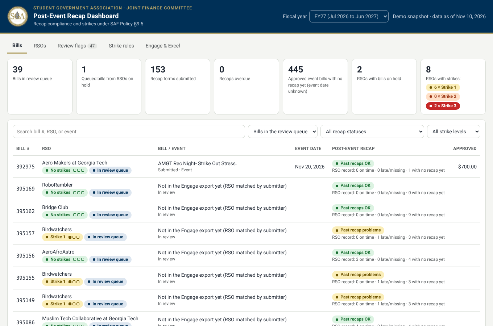
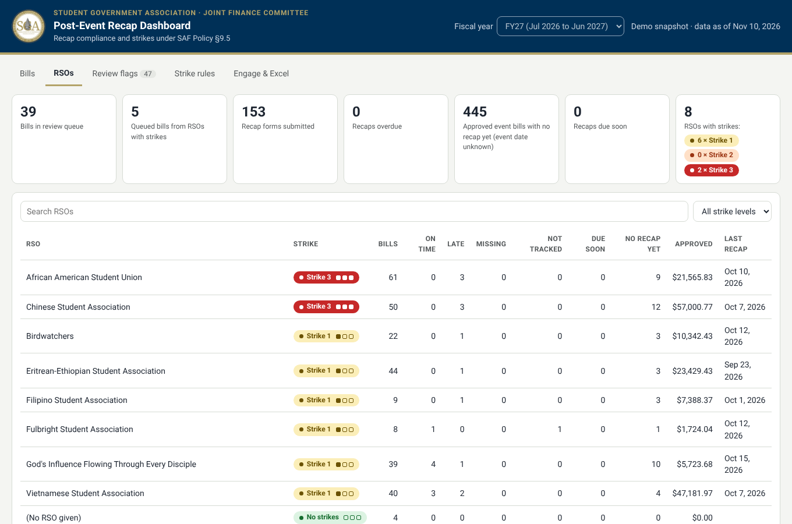

# JFC Post-Event Recap Dashboard

A small web app for the Joint Finance Committee. Click any bill and see whether the RSO turned in its Post-Event Recap Form, how many strikes the RSO has. A second view lists every RSO with its full bill and recap history.




It reads three things:

1. **Recap form responses**, the Microsoft Forms export of the Post-Event Recap Form (used as-is, no editing).
2. **The JFC Data Sheet** (Walker's master workbook). The app reads it as-is: it combines the Engage export on "Data Pasting Site" (one row per line item, rolled up to one row per bill), the bill-form answers on "CampusLabs_Budget_Requests" (event date Q8, expected attendance Q10, and the Q3 "have you submitted all recap forms?" answer), and the "Bill Queue" tab. Any other one-row-per-bill Excel/CSV also works.
3. **Strike adjustments** (optional), a small CSV where JFC can waive a strike or add one by hand.

There are three ways to use it, and they all give the same answers:

| Where | How |
|---|---|
| **Dashboard** (this app) | `start.bat` / `start.sh`, then open http://localhost:8000. |
| **Excel** | An Office Script (`excel/RecapStrikeCheck.ts`) run inside the JFC Data Sheet adds color-coded "Recap Check" tabs and a "Bill Lookup" tab. See [Use it inside Excel](#use-it-inside-excel). |
| **Engage** | A "JFC recap check" bookmark. While a bill is open in Engage, one click opens the dashboard on that bill. See [Use it from Engage](#use-it-from-engage). |

## What the dashboard shows

| View | What you get |
|---|---|
| **Bills** | Every bill with the RSO's strike badge and this bill's recap status (on time, late, missing, due soon, attendance not tracked, not required). Click a bill to see which strike the RSO is on, the recap that was filed (attendance, proof link, how the money was used), expected vs. actual attendance, cost per attendee, and a link to the bill in Engage. |
| **RSOs** | Every RSO, sorted worst first. Click one to see its strike history, its on-time rate, every bill and its recap, every recap form it filed (including ones that don't match a bill), and who filed them. |
| **Review flags** | Things a person should check: no readable bill number, bill numbers not in the bills sheet, no proof of attendance, odd attendance answers, an event that drew less than half the expected crowd, duplicate recaps, recaps filed under a different RSO name. Flags are not strikes. |
| **Strike rules** | The exact policy text the strikes come from. |

The summary tiles at the top are clickable shortcuts (for example, "Recaps overdue" filters the bill list).

## Where the strike rules come from

All strike logic is in `jfdc/policy.py` and comes from the **SAF Policy (September 2026), §9.5.1 to §9.5.3, page 22**:

- **§9.5.1**: RSOs that get SAF money for an event must track attendance and submit a Post-Event Recap Form **within 14 calendar days** of the event (bill/budget number, date and location, number of attendees, proof of attendance).
- **§9.5.2**: missing the 14-day deadline, or not tracking attendance, is **a strike**. Strikes add up over the fiscal year (July 1 to June 30) and reset each new fiscal year.

The dashboard shows which strike number each RSO is on. What each strike means is left to JFC.

| Badge | Meaning |
|---|---|
| 🟢 No strikes | No strikes this fiscal year |
| 🟡 Strike 1 | First strike this fiscal year |
| 🟠 Strike 2 | Second strike this fiscal year |
| 🔴 Strike 3 | Third strike this fiscal year |

The RSO Allowable Cost List ("Events" section) also requires a post-event recap for all events and lets JFC use past attendance when applying caps, which is why the dashboard shows expected vs. actual attendance.

### How each bill is judged

- Only **approved event bills** (any Section A line item) submitted on or after July 1, 2026 need a recap. Bills still in review, rejected bills, equipment (Section B) and travel/competition (Section C) bills don't.
- Event date comes from the bill form (Q8). If that's missing, it is read from the date the RSO typed on the recap form, and the dashboard says so.
- Deadline = event date + 14 days. A recap counts for a bill when the bill number appears anywhere in the form's "Bill/Budget Number" answer (it understands `Bill #377345`, `376684, 375615`, `[Bill #26909]`, `380761 AO1 Line 1`, and so on).
- **Missing**: no recap and the deadline has passed. Strike.
- **Late**: the first recap came in after the deadline. Strike.
- **Attendance not tracked**: the recap has no readable attendance number or no proof of attendance. Strike, even though the form was sent (§9.5.2 says submitting the form does not remove it).
- **Recap not due yet** / **Event hasn't happened**: no strike yet; shows days left.
- **No recap yet (event date unknown)**: an approved event bill with no recap and no event date anywhere. This is not a strike, because the deadline can't be worked out. The Engage export only carries Q8 event dates for bills in the current queue, so most older bills land here. Adding the full "CampusLabs_Budget_Requests" export (all FY27 bills, not just the queue) to the JFC Data Sheet turns these into real on-time / missing results.
- On a bill where the RSO answered "Yes" to Q3 ("Have you submitted Post-Event Recap Forms for ALL events?") while it has overdue recaps, the dashboard raises a review flag.
- **No recap required**: the bill wasn't approved (see `statuses_requiring_recap`) or is an equipment purchase (see `categories_exempt_from_recap`).
- Strikes are numbered by date. For a second strike, the 30-day freeze starts on the day that strike's recap was submitted.

These are computed suggestions. JFC can override any of them in the adjustments CSV (below).

## Run it on your computer (5 minutes)

You need Python 3.10 or newer ([python.org/downloads](https://www.python.org/downloads/); on Windows tick "Add Python to PATH").

**Windows:** double-click `start.bat`.
**Mac:** open Terminal in this folder and run `./start.sh`.

Both set everything up the first time and open http://localhost:8000. It starts with the made-up sample data in `sample_data/` so you can click around right away.

Manual way:

```bash
python -m venv .venv
source .venv/bin/activate          # Windows: .venv\Scripts\activate
pip install -r requirements.txt
python app.py
```

## Use the real data

1. **Recap responses.** In Microsoft Forms, open the Post-Event Recap Form, go to **Responses**, and choose **Open results in Excel** (or download). Save it as `data/recap_responses.xlsx`.
2. **Bills.** Save the JFC Data Sheet as `data/JFC_Data_Sheet.xlsx` (or point at the OneDrive-synced copy, below). It is detected automatically.
3. Open `config.json` and change the two paths:
   ```json
   "recap_source": { "type": "file", "path": "data/recap_responses.xlsx" },
   "bills_source": { "type": "file", "path": "data/JFC_Data_Sheet.xlsx", "history_fiscal_years": 2 },
   "adjustments_source": { "type": "file", "path": "data/strike_adjustments.csv" }
   ```
   `history_fiscal_years: 2` loads this year's and last year's bills (more history makes the RSO pages richer, but loading takes longer; the full sheet takes about 12 seconds).
4. Restart the app (or just click **Refresh now**).

You can also leave `config.json` alone and set environment variables instead: `RECAP_SOURCE`, `BILLS_SOURCE`, `ADJUSTMENTS_SOURCE`.

### Matching your bills sheet's columns

Only two columns are required: the **bill number** and the **RSO name**. The dashboard looks for common header names automatically. If your sheet uses different headers, add them to the lists under `bill_columns` in `config.json`. For example, if your event date column is called "Date of Program":

```json
"event_date": ["Date of Program", "Event Date", "Event Start"],
```

| Field | Needed for |
|---|---|
| `bill_number`, `rso` | Required |
| `event_date` | Recap deadlines and strikes. Without it the dashboard can only say whether a recap exists. A blue banner appears if it's missing. |
| `status` | Deciding which bills need a recap (only approved/funded ones). If there's no status column, every bill needs one. |
| `category` | Skipping equipment purchases. |
| `title`, `amount_requested`, `amount_approved`, `expected_attendance`, `submitted_date` | Extra detail, cost per attendee, and the low-attendance flag. |
| `engage_id` | The "Open in Engage" link. If missing, the bill number is used in the link. If Engage's review ID differs from the bill number, add an Engage ID column. |

To check what got matched, open http://localhost:8000/api/data and look at the `columns` section at the end.

### Strike adjustments (waive or add a strike)

`data/strike_adjustments.csv`:

```csv
RSO,Bill Number,Action,Date,Reason
Jazz Ensemble Club,500901,waive,2026-10-15,Extension granted by JVPF over email
Campus Film Society,500503,add,2026-10-20,Proof of attendance was from a different event
```

`waive` cancels the automatic strike on that bill. `add` records a strike by hand on that date. See `sample_data/strike_adjustments.csv`.

## Use it inside Excel

`excel/RecapStrikeCheck.ts` is an Office Script, so it runs inside Excel on the web with no install. It uses the same rules as the dashboard (they were checked against each other on the real data: same 8 RSOs with strikes, same statuses).

One-time setup:

1. Open the JFC Data Sheet in **Excel on the web** (office.com, signed in with GT).
2. Go to the **Automate** tab and click **New Script**.
3. Delete the sample code, paste in the whole of `excel/RecapStrikeCheck.ts`, and **Save** it as "Recap Strike Check".
4. Add a sheet called **Recap Responses** and paste the Post-Event Recap Form export into it (headers in row 1, exactly as Forms exports them).

Each time:

1. Refresh the "Recap Responses" sheet (paste the latest export over it).
2. Automate > **Recap Strike Check** > **Run**.

It writes three tabs (it replaces them each run and doesn't touch anything else):

- **Recap Check**: one row per bill, queue first, with the recap status and the RSO's strike level colored like the dashboard (green, yellow, orange, red), plus the strike count. Filters are turned on.
- **Recap Check RSOs**: one row per RSO with strike count, level, review status, and strike history.
- **Bill Lookup**: type a bill number in the yellow cell B2 and see that bill's recap status, and which strike the RSO is on.

To have it run on its own, open Power Automate and make a scheduled flow with the "Run script" action (Excel Online (Business)) pointing at this workbook and script. If the Automate tab is missing, GT's Microsoft 365 settings may not allow Office Scripts for your account; the dashboard covers the same ground.

## Use it from Engage

Engage doesn't allow add-ons, so this uses a browser bookmark instead:

1. Open the dashboard and go to the **Engage & Excel** tab.
2. Drag the **JFC recap check** button to the bookmarks bar.
3. In Engage, open any bill (for example `gatech.campuslabs.com/engage/budgeting/reviews#/edit/395191`) and click the bookmark. The dashboard opens on that bill (the number in the Engage address is the bill number) with the RSO's strikes and recap history. If the bill isn't in the data yet, the dashboard says so; the JFC Data Sheet is refreshed twice a week.

The bookmark points at wherever the dashboard is running (http://localhost:8000 by default), so make it from the copy you'll use.

## Make a demo page to share

```bash
python scripts/build_demo.py --out demo.html
```

This writes one self-contained HTML file with a snapshot of the current data. It opens by double-click, needs no Python, and drops submitter names, emails and proof links (add `--keep-names` to keep them). It's a snapshot, so it doesn't refresh.

## Keeping it up to date automatically

The JFC Data Sheet itself is only refreshed twice a week (Monday/Tuesday and Wednesday/Thursday, per its "Notes and Guidelines on Data" tab), so new bills can take a few days to appear no matter which copy you look at.


The app re-reads a data file the moment it changes, and the page refreshes itself every 60 seconds (`refresh_seconds` in `config.json`). So the trick is to make the files on disk update themselves.

### Option A (recommended): sync the SharePoint/OneDrive files

This is the easiest fix for "it won't update on my end," because it uses the same Microsoft sign-in you already have and needs no IT approval.

1. Open the master bills sheet link in a browser. In the OneDrive/SharePoint folder that holds it, click **Add shortcut to My files** (or **Sync**).
2. Do the same for the Excel workbook that holds the Forms responses (from Forms: Responses > Open results in Excel, then use that workbook's folder).
3. Install the OneDrive desktop app if needed and sign in with your GT account. The files now appear in File Explorer / Finder under `OneDrive - Georgia Institute of Technology` (Windows) or `~/Library/CloudStorage/OneDrive-GeorgiaInstituteofTechnology` (Mac).
4. Point `config.json` at those synced files, for example:
   ```json
   "recap_source": { "type": "file", "path": "C:/Users/you/OneDrive - Georgia Institute of Technology/Post Event Recap Form.xlsx" }
   ```

OneDrive keeps the copy current, and the dashboard notices each change. (If your copy stopped updating before, it was most likely a downloaded copy or a file that wasn't syncing. Check the OneDrive icon for a green check mark.)

### Option B: live Microsoft Graph connection

The code for this is in `jfdc/sources.py` (`GraphShareLinkSource`). It downloads the workbook straight from a SharePoint sharing link every 5 minutes. It needs an Azure app registration in GT's tenant (public client, delegated `Files.Read.All`), which GT OIT may have to approve. Once you have a client ID:

```bash
export GRAPH_CLIENT_ID=<your app's client id>
export BILLS_SOURCE="https://gtvault-my.sharepoint.com/:x:/g/personal/...your sharing link..."
python app.py
```

The first run prints a code and a URL. Sign in with a GT account that can open the file, and the token is cached in `.graph_token_cache.json` (git-ignored).

### Option C: Engage

Engage's budgeting API needs an API key from the Engage admin (Center for Student Engagement). `EngageSource` in `jfdc/sources.py` is the place to add it. Until then, export from Engage and use Option A or a manual file.

All data loading goes through `make_source()` in `jfdc/sources.py`, so adding a new connection doesn't touch the rest of the app.

## SGA look and logo

The dashboard uses the Georgia Tech colors that sga.gatech.edu uses (Navy Blue #003057 and Tech Gold #B3A369) and the Roboto typeface. The SGA seal is in `static/logo.png` and shows in the header and browser tab. To swap it, replace that file (if it goes missing, a gold "SGA" badge shows instead). `python scripts/build_demo.py --with-logo` embeds the logo in the demo page too.

## Will it keep working on live data?

Yes, as long as these stay true. If one changes, the dashboard shows a blue banner saying which column it can't find, instead of quietly showing wrong numbers.

| Source | What it relies on | What happens when it updates |
|---|---|---|
| Post-Event Recap Form responses (Forms "Open in Excel" workbook) | Columns are found by the start of each question's wording ("Bill/Budget Number", "Please select your RSO", "Number of Attendees", "Proof of Attendance", "Completion time"). Column order doesn't matter. | New responses appear in that workbook automatically. If the dashboard reads the OneDrive-synced copy, it picks them up within a minute. If a question is reworded, add the new wording to `recap_columns` in `config.json`. |
| JFC Data Sheet | Tab names "Data Pasting Site", "CampusLabs_Budget_Requests", "Bill Queue", and the Engage export headers (Id, ProcessName, SubmittedOnBehalfOf, Status, RequestedAmount, AdjustedAmount, SectionName, FirstSubmitted). | Every time Walker pastes a new Engage export (twice a week), the next refresh uses it. If a tab is renamed, change the names at the top of `jfdc/jfc_sheet.py` (and of `excel/RecapStrikeCheck.ts`). |
| Engage | Nothing directly. Engage data reaches the dashboard only through the export Walker pastes into the JFC Data Sheet. The bookmark only opens the dashboard on the bill in the address bar. | A live Engage connection needs an API key from the Center for Student Engagement; `EngageSource` in `jfdc/sources.py` is where it goes. |
| Next fiscal year | The bill process name (it matches "Bills Process" in any FY) and July 1 resets. | Strikes reset on their own. Update `recap_policy_start` in `config.json` if the rule's start date changes. |

Things that have not been tested yet: the Office Script inside GT's Excel (its logic was tested against the real data, but not in Excel itself), reading files from a OneDrive-synced folder on Walker's laptop, and the Microsoft Graph option, which needs GT approval.

## Put it on GitHub

The data files hold student names and emails, so **make the repository private**. `.gitignore` already keeps `data/`, real `.xlsx` files, and the Graph token out of git; only the fake `sample_data/` is committed.

On github.com: **New repository**, name it (for example `jfc-recap-dashboard`), choose **Private**, create it, then either drag this whole folder onto **uploading an existing file**, or:

```bash
git init
git add .
git commit -m "JFC post-event recap dashboard"
git branch -M main
git remote add origin https://github.com/<you>/jfc-recap-dashboard.git
git push -u origin main
```

Walker (or whoever is JFC president) then clones it, runs `start.bat` / `start.sh`, and points `config.json` at his own synced files. Because each person's copy reads their own synced files, the president's copy keeps updating even if yours doesn't.

## Hosting it online (optional)

Running it on the president's laptop is simplest and keeps the data private. If you want a shared URL instead:

- The host can't see anyone's OneDrive, so it needs Option B (Graph) for live data.
- Always set `DASHBOARD_PASSWORD` so the page asks for a password (any username works).
- `render.yaml` is included for [Render](https://render.com): New > Blueprint, pick the repo, fill in the environment variables.

## Project layout

```
app.py                  Flask web server (/ and /api/data)
config.json             File paths, column mapping, and rule settings
jfdc/sources.py         Where data comes from (file, Microsoft Graph, Engage placeholder)
jfdc/jfc_sheet.py       Reads the JFC Data Sheet's tabs and rolls line items up to bills
jfdc/parsing.py         Cleans free-text answers: bill numbers, attendance, RSO names, dates
jfdc/policy.py          Strike levels and quotes from the SAF Policy
jfdc/engine.py          Matches recaps to bills and works out statuses and strike numbers
static/                 The web page (plain HTML/CSS/JS, no build step)
sample_data/            Made-up data for trying it out
scripts/make_sample_data.py   Rebuilds the sample data
scripts/build_demo.py   Builds a shareable one-file demo page
excel/RecapStrikeCheck.ts     Office Script: the same check inside Excel
excel/test/             Runs the Office Script logic in Node against exported data
tests/                  python -m pytest -q
```

## Known limits (MVP)

- Missing-recap strikes need an event date. The bill form's Q8 answer is only in the sheet for queued bills, so for most older bills the dashboard can say "no recap yet" but can't yet say "overdue". Late recaps are still caught using the date the RSO typed on the recap form.
- Bills in the queue that are newer than the Engage export get their RSO from the submitter's most recent other bill. The dashboard labels these.
- RSO names are matched loosely ("Billiard Club at GT" = "billiard club @ GT"), and a recap that cites a bill number is always tied to that bill's RSO. Names that are spelled very differently and cite no bill number will show up as separate RSOs.
- A recap filed before the bills sheet is updated shows in Review flags as "not in the bills sheet" until the sheet catches up.
- Times use the computer's clock; set `JFDC_TODAY=2026-11-10` to test as if it were another day.
